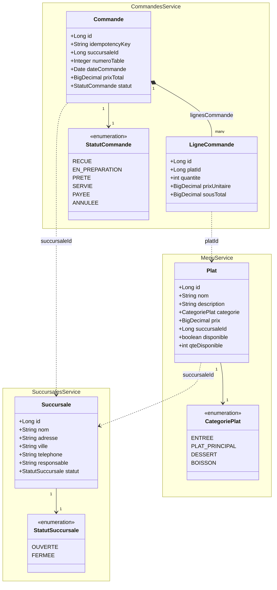
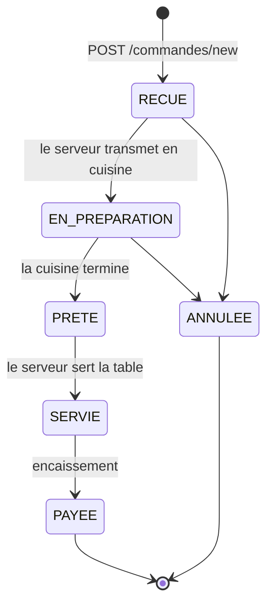
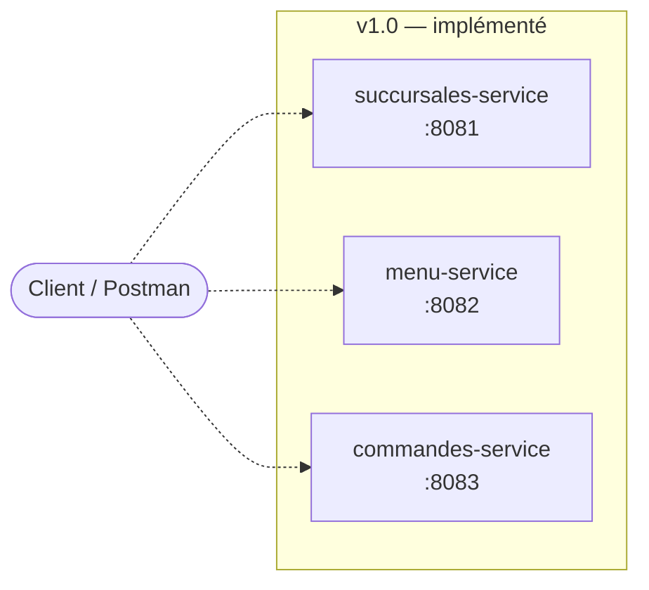

# Restaurant Chain Platform

Plateforme de gestion pour une **chaîne de restaurants multi-succursales**, bâtie en architecture microservices (Spring Boot / Spring Cloud).

Chaque succursale gère son propre menu et ses propres commandes. Une commande suit un **workflow d'états** représentant son cycle de vie réel en salle : reçue par le serveur, préparée en cuisine, prête, servie, puis payée — avec possibilité d'annulation tant qu'elle n'a pas été servie.

> **État du projet : jalon v1.0.** Seuls les services métier ci-dessous sont implémentés. Le registre de service, la passerelle, la configuration centralisée et la communication interservices sont prévus aux jalons suivants (voir [Feuille de route](#feuille-de-route)). Ce README est mis à jour à chaque jalon livré.

## Sommaire

- [Description](#description)
- [Modèle de données (UML)](#modèle-de-données-uml)
- [Workflow d'une commande](#workflow-dune-commande)
- [Architecture — état actuel (v1.0)](#architecture--état-actuel-v10)
- [Démarrage](#démarrage)
- [Feuille de route](#feuille-de-route)
- [Historique des versions](#historique-des-versions)

## Description

Le projet est découpé en trois services métier autonomes, chacun avec sa propre base de données :

| Service | Rôle | Port | Endpoint principal |
|---|---|---|---|
| `succursales-service` | Référentiel des succursales de la chaîne (adresse, ville, responsable, statut) | 8081 | `/succursales` |
| `menu-service` | Plats proposés par chaque succursale, disponibilité et quantité restante du jour | 8082 | `/plats` |
| `commandes-service` | Commandes passées en salle, lignes de commande, workflow de statuts | 8083 | `/commandes` |

Chaque service expose une API REST (couches Controller / Service / Repository, DTO validés, MapStruct pour le mapping, gestion d'erreurs par exceptions dédiées avec codes HTTP appropriés) et persiste ses données dans une base H2 en mémoire, peuplée au démarrage via `data.sql`.

## Modèle de données (UML)

Les flèches pleines représentent les relations internes à un service (JPA). Les flèches pointillées représentent une **dépendance logique inter-services** (référence par identifiant uniquement ; aucun appel réseau n'est encore implémenté — prévu au jalon OpenFeign) :



## Workflow d'une commande

C'est le cœur métier du projet : une commande ne peut pas changer de statut n'importe comment. Les transitions autorisées sont centralisées et validées côté serveur (`TransitionStatutValidator`), avec retour **409 Conflict** sur toute transition invalide (ex. impossible d'annuler une commande déjà servie, impossible de sauter une étape) :



Transition réalisée via `PATCH /commandes/{id}/statut`.

## Architecture — état actuel (v1.0)

Les trois services tournent **indépendamment**, chacun avec sa base H2 propre, sans découverte de service ni passerelle pour l'instant :



## Démarrage

Prérequis : JDK 17.

```powershell
.\mvnw.cmd clean verify

.\mvnw.cmd -pl succursales-service spring-boot:run
.\mvnw.cmd -pl menu-service spring-boot:run
.\mvnw.cmd -pl commandes-service spring-boot:run
```

Vérification rapide :

```text
http://localhost:8081/succursales
http://localhost:8082/plats
http://localhost:8083/commandes
```

Documentation interactive (Swagger UI) sur chaque service : `http://localhost:<port>/swagger-ui.html`.

## Feuille de route

Chaque jalon ajoute une brique d'infrastructure ou de communication, appliquée à ce projet. L'architecture cible complète (5 applications : 3 services métier + Eureka + Gateway, avant l'ajout ultérieur de Config Server, RabbitMQ puis Kafka) sera documentée et mise à jour ici à mesure de sa réalisation.

| Jalon | Contenu | Statut |
|---|---|---|
| Init | Conception, UML, architecture | Fait |
| v1.0 | Services métier (ce README) | Fait |
| v2.0 | Eureka + API Gateway | À venir |
| v3.0 | Config Server | À venir |
| v4.0 | Communication synchrone (OpenFeign) | À venir |
| v5.0 | Communication asynchrone (RabbitMQ) | À venir |
| v6.0 | Résilience (Circuit Breaker, Retry, idempotence) | À venir |
| v7.0 | Migration RabbitMQ → Kafka | À venir |

## Historique des versions

### v1.0
- Trois services métier opérationnels : `succursales-service`, `menu-service`, `commandes-service`.
- Couches Controller / Service / Repository, DTO validés (Bean Validation), mapping MapStruct.
- Gestion d'erreurs par exceptions dédiées (404 ressource introuvable, 400 données invalides, 409 stock insuffisant / transition invalide).
- Réservation de stock sur `menu-service` avec verrou pessimiste pour éviter les doubles réservations concurrentes.
- Workflow de statuts de commande avec machine à états validée côté serveur et testée unitairement.
- Jeux de données de démonstration (`data.sql`) et documentation Swagger sur chaque service.
