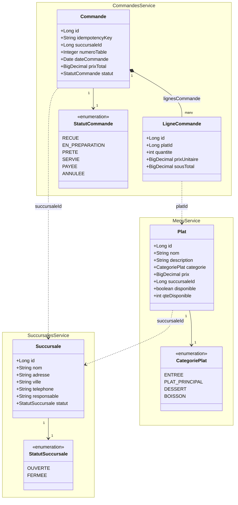
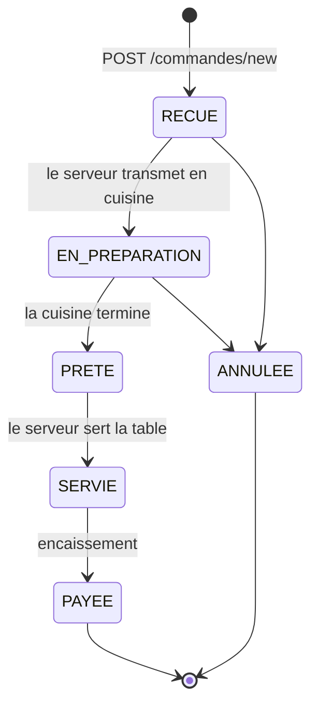
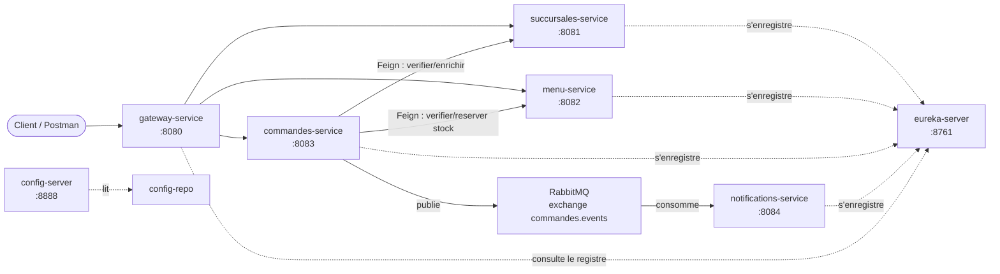
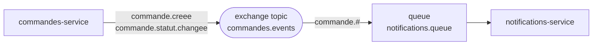

# Restaurant Chain Platform

Plateforme de gestion pour une **chaîne de restaurants multi-succursales**, bâtie en architecture microservices (Spring Boot / Spring Cloud).

Chaque succursale gère son propre menu et ses propres commandes. Une commande suit un **workflow d'états** représentant son cycle de vie réel en salle : reçue par le serveur, préparée en cuisine, prête, servie, puis payée — avec possibilité d'annulation tant qu'elle n'a pas été servie.

> **État du projet : jalon v6.0.** Les services métier sont enregistrés auprès d'un registre Eureka, accessibles via une passerelle API, communiquent entre eux via OpenFeign (avec Circuit Breaker et Retry) lors de la création d'une commande, et publient des événements RabbitMQ consommés de façon asynchrone par `notifications-service`. Le Config Server existe (`config-server` + `config-repo`) mais les services ne le consomment pas encore (jalon v3.0 partiel — migration restante). Voir [Feuille de route](#feuille-de-route). Ce README est mis à jour à chaque jalon livré.

## Sommaire

- [Description](#description)
- [Modèle de données (UML)](#modèle-de-données-uml)
- [Workflow d'une commande](#workflow-dune-commande)
- [Architecture — état actuel](#architecture--état-actuel)
- [Communication interservices (OpenFeign)](#communication-interservices-openfeign)
- [Communication asynchrone (RabbitMQ)](#communication-asynchrone-rabbitmq)
- [Résilience (Circuit Breaker, Retry)](#résilience-circuit-breaker-retry)
- [Démarrage](#démarrage)
- [Feuille de route](#feuille-de-route)
- [Historique des versions](#historique-des-versions)

## Description

Le projet est découpé en services métier autonomes, chacun avec sa propre base de données :

| Service | Rôle | Port | Endpoint principal |
|---|---|---|---|
| `succursales-service` | Référentiel des succursales de la chaîne (adresse, ville, responsable, statut) | 8081 | `/succursales` |
| `menu-service` | Plats proposés par chaque succursale, disponibilité et quantité restante du jour | 8082 | `/plats` |
| `commandes-service` | Commandes passées en salle, lignes de commande, workflow de statuts | 8083 | `/commandes` |
| `notifications-service` | Historique des notifications générées par le cycle de vie d'une commande (consommateur RabbitMQ) | 8084 | `/notifications` |

Chaque service expose une API REST (couches Controller / Service / Repository, DTO validés, MapStruct pour le mapping, gestion d'erreurs par exceptions dédiées avec codes HTTP appropriés) et persiste ses données dans une base H2 en mémoire, peuplée au démarrage via `data.sql`.

## Modèle de données (UML)

Les flèches pleines représentent les relations internes à un service (JPA). Les flèches pointillées représentent une **dépendance inter-services** : `commandes-service` vérifie et enrichit ces références par un appel OpenFeign réel ; `menu-service` ne fait que stocker `succursaleId` sans appeler `succursales-service` :



## Workflow d'une commande

C'est le cœur métier du projet : une commande ne peut pas changer de statut n'importe comment. Les transitions autorisées sont centralisées et validées côté serveur (`TransitionStatutValidator`), avec retour **409 Conflict** sur toute transition invalide (ex. impossible d'annuler une commande déjà servie, impossible de sauter une étape) :



Transition réalisée via `PATCH /commandes/{id}/statut`.

## Architecture — état actuel

Les services métier s'enregistrent auprès d'un registre **Eureka**, sont accessibles via une **API Gateway** unique (deux profils : routage statique déclaratif, ou routage dynamique généré depuis la découverte de service), `commandes-service` appelle directement `succursales-service` et `menu-service` via **OpenFeign** pour valider et enrichir ses commandes, et publie des événements sur **RabbitMQ** que `notifications-service` consomme de façon asynchrone :



| Application | Port |
|---|---|
| `eureka-server` | 8761 |
| `gateway-service` | 8080 |
| `succursales-service` | 8081 |
| `menu-service` | 8082 |
| `commandes-service` | 8083 |
| `notifications-service` | 8084 |
| `config-server` | 8888 |

`config-server` sert la configuration centralisée depuis `config-repo` (profil `native`), mais aucun service ne la consomme encore — ils gardent pour l'instant leur `application.properties` local (migration restante du jalon v3.0).

### Routage statique vs dynamique

- **Statique** (`application-statique.properties`) : les routes `lb://SUCCURSALES-SERVICE`, `lb://MENU-SERVICE`, `lb://COMMANDES-SERVICE` sont déclarées explicitement, mais l'adresse/port de chaque instance reste résolu via Eureka.
- **Dynamique** (`application-dynamique.properties`) : les routes sont générées automatiquement pour chaque service présent dans le registre (`discovery.locator`), via `/succursales-service/succursales`, `/menu-service/plats`, `/commandes-service/commandes`.

Un seul profil est actif à la fois (même module, port 8080).

## Communication interservices (OpenFeign)

À la création d'une commande (`POST /commandes/new`), `commandes-service` ne fait plus confiance aux identifiants reçus : il vérifie chaque référence auprès du service propriétaire avant d'enregistrer quoi que ce soit.

1. **Succursale** — `SuccursaleClient` interroge `succursales-service` ; la commande est refusée si la succursale est introuvable ou si elle est fermée (`FERMEE`).
2. **Plats** — pour chaque ligne, `MenuClient` interroge `menu-service` : le plat doit exister, appartenir à la même succursale, et son stock est réservé via `POST /plats/{id}/stock/reserver` (verrou pessimiste côté `menu-service`). Le prix unitaire vient du serveur (`menu-service`), jamais du client.
3. **Idempotence** — l'en-tête `idempotencyKey` est obligatoire ; une seconde requête avec la même clé renvoie la commande déjà créée au lieu d'en créer une seconde (utile en cas de retentative réseau depuis le client).
4. **Gestion des erreurs** — les réponses des services distants sont traduites en erreurs métier locales :

   | Situation distante | Exception locale | HTTP |
   |---|---|---|
   | Succursale ou plat introuvable (404) | `RessourceIntrouvableException` | 404 |
   | Succursale fermée | `SuccursaleFermeeException` | 409 |
   | Plat d'une autre succursale | `DonneesInvalidesException` | 400 |
   | Stock insuffisant (409 de `menu-service`) | `StockInsuffisantException` | 409 |
   | Service distant injoignable / timeout | `ServiceIndisponibleException` | 503 |

**Consultation enrichie** — `GET /commandes/{id}` complète la réponse avec le nom/ville de la succursale et le nom de chaque plat (récupérés via Feign). Contrairement à la création, une consultation ne doit pas échouer à cause d'une dépendance en panne : l'enrichissement se dégrade silencieusement (champs laissés vides) si `succursales-service` ou `menu-service` est indisponible.

Limite connue à ce jalon : si la réservation de stock échoue sur une ligne après avoir réussi sur une ligne précédente, le stock déjà réservé n'est pas restitué (pas de compensation/saga). Une piste pour un jalon ultérieur si le besoin se confirme.

## Communication asynchrone (RabbitMQ)

En plus des appels synchrones OpenFeign (nécessaires pour valider une commande avant de l'enregistrer), `commandes-service` publie des **événements** décrivant le cycle de vie d'une commande, sans attendre ni connaître ses consommateurs :

- `commande.creee` : publié juste après l'enregistrement d'une nouvelle commande.
- `commande.statut.changee` : publié après chaque transition de statut validée (`PATCH /commandes/{id}/statut`).

Les deux routing keys sont envoyées sur l'exchange topic `commandes.events`. `notifications-service` déclare une queue `notifications.queue` liée avec le pattern `commande.#`, consomme ces événements (`@RabbitListener`) et les conserve comme historique consultable via `GET /notifications` (et `GET /notifications/commande/{id}`) — une simulation simple d'un canal de notification vers la cuisine ou le personnel de salle.



La publication est **best-effort** : si RabbitMQ est indisponible, `commandes-service` journalise un avertissement et poursuit normalement (la création/mise à jour de la commande reste la donnée de référence ; la notification est un canal annexe, pas une dépendance bloquante).

## Résilience (Circuit Breaker, Retry)

Les appels OpenFeign de `commandes-service` vers `succursales-service` et `menu-service` sont enveloppés (`ResilientSuccursaleClient`, `ResilientMenuClient`) avec **Resilience4j** :

- **Retry** — jusqu'à 3 tentatives (attente 500 ms entre chaque) uniquement sur `feign.RetryableException`, c'est-à-dire une panne de connectivité (service injoignable, timeout). Une erreur métier (404, 409) est déterministe : la retenter ne changerait rien, elle n'est donc jamais retentée.
- **Circuit Breaker** — après plusieurs échecs de connectivité consécutifs (fenêtre glissante de 10 appels, seuil de 50 %), le circuit s'ouvre et les appels suivants échouent immédiatement (`CallNotPermittedException`, traduite en `ServiceIndisponibleException` / 503) au lieu d'attendre inutilement un service down. Il se referme automatiquement après 10 secondes pour retester. Comme pour le Retry, seules les pannes de connectivité comptent dans le taux d'échec — une 404 ne doit pas faire croire que le service est en panne.
- **Idempotence** — déjà en place depuis le jalon v4.0 (en-tête `idempotencyKey` sur `POST /commandes/new`) : une requête rejouée après un retry côté client ne crée jamais de doublon.

État des circuits consultable via `http://localhost:8083/actuator/circuitbreakers` (et l'historique des événements via `/actuator/circuitbreakerevents`).

## Démarrage

Prérequis : JDK 17, et un broker RabbitMQ local pour tester la publication/consommation d'événements (sinon la plateforme fonctionne quand même, en mode dégradé — voir [Communication asynchrone](#communication-asynchrone-rabbitmq)) :

```powershell
docker run -d --name rabbitmq -p 5672:5672 -p 15672:15672 rabbitmq:3-management
```

```powershell
.\mvnw.cmd clean verify

.\mvnw.cmd -pl eureka-server spring-boot:run
.\mvnw.cmd -pl config-server spring-boot:run
.\mvnw.cmd -pl succursales-service spring-boot:run
.\mvnw.cmd -pl menu-service spring-boot:run
.\mvnw.cmd -pl commandes-service spring-boot:run
.\mvnw.cmd -pl notifications-service spring-boot:run
.\mvnw.cmd -pl gateway-service spring-boot:run "-Dspring-boot.run.profiles=dynamique"
```

(`config-server` n'est pas encore consommé par les autres services — son démarrage n'est pas indispensable pour tester le reste de la plateforme)

Historique des notifications : `http://localhost:8084/notifications`. Console de gestion RabbitMQ : `http://localhost:15672` (guest / guest).

(remplacer `dynamique` par `statique` pour l'autre mode de routage)

Vérification rapide — directement sur les services métier :

```text
http://localhost:8081/succursales
http://localhost:8082/plats
http://localhost:8083/commandes
```

Via la Gateway (profil `statique`) :

```text
http://localhost:8080/succursales
http://localhost:8080/plats
http://localhost:8080/commandes
```

Via la Gateway (profil `dynamique`) :

```text
http://localhost:8080/succursales-service/succursales
http://localhost:8080/menu-service/plats
http://localhost:8080/commandes-service/commandes
```

Registre Eureka : `http://localhost:8761`. Routes de la Gateway : `http://localhost:8080/actuator/gateway/routes`.

Documentation interactive (Swagger UI) sur chaque service métier : `http://localhost:<port>/swagger-ui.html`.

## Feuille de route

Chaque jalon ajoute une brique d'infrastructure ou de communication, appliquée à ce projet.

| Jalon | Contenu | Statut |
|---|---|---|
| Init | Conception, UML, architecture | Fait |
| v1.0 | Services métier | Fait |
| v2.0 | Eureka + API Gateway (routage statique et dynamique) | Fait |
| v3.0 | Config Server | Partiel (serveur créé, migration des services restante) |
| v4.0 | Communication synchrone (OpenFeign) | Fait |
| v5.0 | Communication asynchrone (RabbitMQ) | Fait |
| v6.0 | Résilience (Circuit Breaker, Retry, idempotence) | Fait |
| v7.0 | Migration RabbitMQ → Kafka | À venir |

## Historique des versions

### v6.0
- Ajout de **Resilience4j** (`resilience4j-spring-boot3`) sur `commandes-service` : les appels Feign vers `succursales-service` et `menu-service` passent désormais par `ResilientSuccursaleClient` / `ResilientMenuClient`.
- **Retry** (3 tentatives, 500 ms) et **Circuit Breaker** (fenêtre de 10 appels, seuil 50 %, réouverture après 10 s) configurés pour ne réagir qu'aux pannes de connectivité (`feign.RetryableException`), jamais aux erreurs métier déterministes (404/409).
- `CallNotPermittedException` (circuit ouvert) traduite en `ServiceIndisponibleException` (503), au même titre qu'une panne de connectivité classique.
- Endpoints Actuator `circuitbreakers` et `circuitbreakerevents` exposés pour inspecter l'état des circuits.
- L'idempotence sur `POST /commandes/new` (jalon v4.0) complète ce jalon : elle protège déjà contre les doublons créés par un client qui retenterait sa requête après un timeout.

### v5.0
- Ajout de `notifications-service` (8084) : consomme les événements de commande et conserve un historique interrogeable (`GET /notifications`, `GET /notifications/commande/{id}`).
- `commandes-service` publie deux événements via **RabbitMQ** (exchange topic `commandes.events`) : `commande.creee` à la création, `commande.statut.changee` à chaque transition de statut validée.
- Publication best-effort : une panne du broker est journalisée côté `commandes-service` sans jamais faire échouer la création ou la mise à jour d'une commande.
- Tests unitaires du publisher (routing keys, dégradation si RabbitMQ indisponible) et du service de notifications.

### v4.0
- `commandes-service` communique avec `succursales-service` et `menu-service` via **OpenFeign** (`SuccursaleClient`, `MenuClient`), résolus par Eureka.
- Création de commande contrôlée : vérification de la succursale (existence + statut ouvert), vérification que chaque plat appartient à la bonne succursale, réservation réelle du stock, prix calculé côté serveur.
- Idempotence sur `POST /commandes/new` via l'en-tête `idempotencyKey` : une requête rejouée renvoie la commande déjà créée.
- Gestion différenciée des erreurs distantes : 404 → ressource introuvable, 409 → stock insuffisant ou succursale fermée, erreur de communication → 503 (`ServiceIndisponibleException`).
- `GET /commandes/{id}` enrichi avec le nom/ville de la succursale et le nom de chaque plat, avec dégradation silencieuse si un service distant est indisponible.
- Tests unitaires de `CommandeService` avec les clients Feign mockés (idempotence, règles métier, traduction des erreurs).

### v3.0 (partiel)
- Ajout de `config-server` (8888, `@EnableConfigServer`, profil `native`) et de `config-repo/application.properties` (configuration globale partagée : registre Eureka, exposition Actuator).
- Migration des services métier vers cette configuration centralisée non encore réalisée.

### v2.0
- Ajout de `eureka-server` (8761) : registre de services, ne s'enregistre pas lui-même (`register-with-eureka=false`, `fetch-registry=false`).
- Ajout de `gateway-service` (8080, Spring Cloud Gateway sur WebFlux) avec deux profils :
  - `statique` : routes déclarées explicitement (`lb://SUCCURSALES-SERVICE`, `lb://MENU-SERVICE`, `lb://COMMANDES-SERVICE`).
  - `dynamique` : routes générées automatiquement par découverte de service (`discovery.locator`), préfixées par le nom du service.
- Les trois services métier s'enregistrent désormais auprès d'Eureka (`spring-cloud-starter-netflix-eureka-client`).
- Endpoint `/actuator/gateway/routes` exposé pour inspecter les routes actives.

### v1.0
- Trois services métier opérationnels : `succursales-service`, `menu-service`, `commandes-service`.
- Couches Controller / Service / Repository, DTO validés (Bean Validation), mapping MapStruct.
- Gestion d'erreurs par exceptions dédiées (404 ressource introuvable, 400 données invalides, 409 stock insuffisant / transition invalide).
- Réservation de stock sur `menu-service` avec verrou pessimiste pour éviter les doubles réservations concurrentes.
- Workflow de statuts de commande avec machine à états validée côté serveur et testée unitairement.
- Jeux de données de démonstration (`data.sql`) et documentation Swagger sur chaque service.
